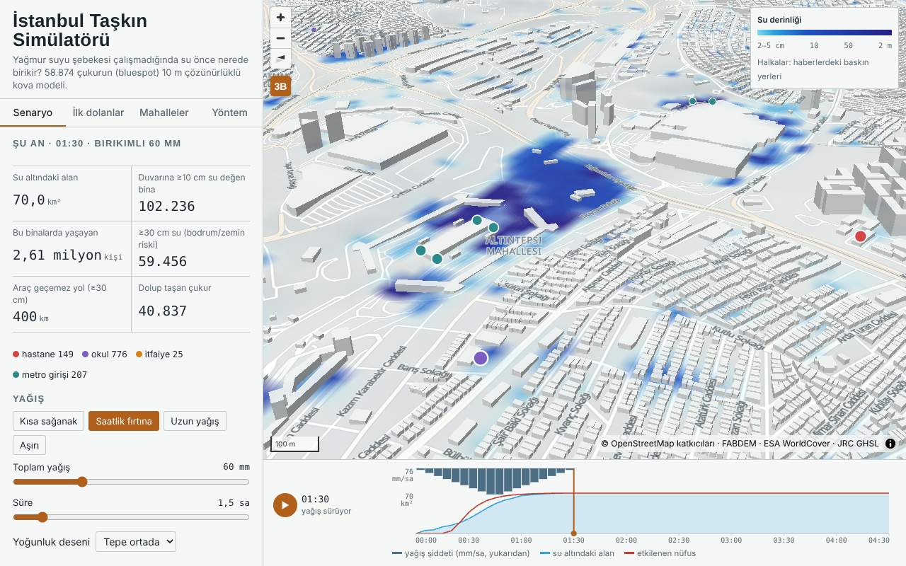

# İstanbul Taşkın Simülatörü

**Yağmur suyu şebekesi çalışmadığında İstanbul'da su önce nerede birikir, kaç milimetre yağışta ve kimi etkiler?**

İstanbul il sınırının tamamı için 10 m çözünürlükte bir "bluespot" (yüzey çukuru) analizi ve bu analizin üzerinde
tarayıcıda çalışan, zaman adımlı bir taşkın simülatörü. Yağış miktarı, süresi ve deseni, drenaj kapasitesi, alt geçit
pompaları, menfez tıkanması, boru patlaması ve 1990 / bugün arazi örtüsü değiştirilebilir; su her an için 1,1 milyon
çukur pikselinde hesaplanıp haritaya (3B dahil) serilir.

**Canlı sürüm:** `web/dist/` (statik; GitHub Pages ile yayımlanır) · Ekran görüntüleri: `docs/`

## Öne çıkan sonuçlar (drenaj devre dışı, düzgün yağış, il içi)

| | 25 mm | 50 mm | 100 mm |
| --- | ---: | ---: | ---: |
| Su altındaki alan | 43,9 km² | 65,8 km² | 76,3 km² |
| Duvarına ≥10 cm su değen bina | 80.106 | 100.067 | 109.083 |
| Bu binalarda yaşayan | 2,19 milyon | 2,57 milyon | 2,73 milyon |
| Su değen hastane / okul / metro girişi | 126 / 700 / 184 | 149 / 767 / 205 | 151 / 795 / 209 |
| Araç geçemez yol (≥30 cm) | 193 km | 383 km | 532 km |

- **58.874 çukur**; 12.129 kentsel çukur 25 mm'de, 3.035'i 10 mm'de doluyor.
- **Sıcak noktalar:** Bağcılar–Esenler–Bayrampaşa–Güngören–Zeytinburnu–Fatih kuşağı (153 mahalle %99 güvenle Gi* sıcak nokta).
- **Kentleşme:** 1990'ın yapılaşmasıyla aynı çukurlardan 25 mm'de dolanlar 9.680 olurdu; bugün 12.162 (+%26). 10 mm'de
  1.673 → 3.038 (+%82).
- **Doğrulama:** haberlerde su bastığı yazan 11 cadde, rastgele caddelerden açıkça ayrılıyor (dolma eşiği AUC 0,83
  [0,74–0,91]); nokta olaylarda sinyal zayıf (AUC ~0,66, güven aralığı 0,5'i içeriyor).
- **Dayanıklılık:** bina, dere ve alt geçit parametreleri sonucu değiştirmiyor; tek tek cadde çukurlarının sırası yol
  alçaltma varsayımına ve DEM hatasına duyarlı, mahalle ve ilçe düzeyindeki sıcak nokta tablosu dayanıklı (mahalle ρ 0,89–0,95).

## Yöntem (kısa)

1. **Girdiler (Google Earth Engine):** FABDEM (bina ve ağaçtan arındırılmış Copernicus DEM), ESA WorldCover 2021,
   HiHydroSoil v2 toprak grubu → SCS eğri numarası; JRC GHSL yapılaşma (1990, 2020) ve nüfus; HydroSHEDS havzaları;
   IMERG yağış serisi; GEDI zemin atışları.
2. **DEM koşullandırma:** köprüler kaldırıldı, binalar +5 m, yollar −0,3 m, dereler ve menfezler oyuldu, alt geçitler
   eğimli tabanla açıldı, deniz çıkış. Çukurlar doldurulmadı: sonucun kendisi onlar.
3. **Çukur analizi:** Priority-Flood (numba) → çukurlar, yerel havzalar, dolma–taşma ağacı, her çukurun hipsometrisi;
   SCS-CN ile her çukurun "kaç mm'de dolar" eşiği.
4. **Kova motoru:** her 5 dakikada yerel akış → drenaj → taşma zinciri → hipsometriden su seviyesi. Python referansı ve
   tarayıcı (JS) sürümü birebir test edildi (58.874 çukurda seviye farkı ≤ 0,8 cm).
5. **Maruziyet:** bina duvarına değen su, nüfus (GHS-POP → TÜİK toplamına ölçekli, binalara dağıtılmış), yol ağı ve
   hastaneye erişim (çok kaynaklı Dijkstra), kritik tesisler, mahalle risk indeksi ve Getis-Ord Gi*.
6. **Doğrulama:** 22 kaynaklı haber olayı, rastgele nokta/cadde karşılaştırması, AUC ve bootstrap güven aralığı.

Ayrıntı, varsayımlar ve sınırlamalar: [`docs/yontem.md`](docs/yontem.md) · English: [`docs/method_en.md`](docs/method_en.md)

## Depo yapısı

| Klasör | İçerik |
| --- | --- |
| `gee/` | Earth Engine betikleri (Code Editor ve Python) |
| `pipeline/osm/` | OSM özeti ve tematik katmanlar |
| `pipeline/dem/` | DEM koşullandırma |
| `pipeline/cukur/` | Çukur analizi, sınıflandırma, duyarlılık / belirsizlik |
| `pipeline/maruziyet/` | Kova motoru (Python), su derinliği, maruziyet, erişim, mahalle karnesi, kentleşme, menfez |
| `pipeline/web/` | Simülatör veri paketi, altlık karoları, yağış olayları |
| `validation/` | Haber olayları ve doğrulama |
| `web/` | Simülatör (kaynak, testler, `dist/` yayın klasörü) |
| `docs/` | Yöntem notu (TR/EN), proje özeti |

Her klasörün README'si o fazın sonuçlarını ve kontrol notlarını içerir.

## Çalıştırma

Ham ve ara veriler depoda yok (Earth Engine ve OSM'den yeniden üretilir; ~1,5 GB). Sıra:
`gee/` → `pipeline/osm` → `pipeline/dem` → `pipeline/cukur` → `pipeline/maruziyet` → `validation` → `pipeline/web` →
`web/build.py`. Python ≥3.11: numpy, scipy, numba, pandas, geopandas, pyogrio, rasterio, GDAL, pyproj; web için Node ≥18.

## Sınırlamalar

Ön tarama niteliğindedir, resmi taşkın tehlike haritası değildir. DEM 30 m kaynaklıdır; kanalizasyon ağı bilinmez
(drenaj tek bir kapasite parametresi); akış süresi ve kanalizasyonun geri tepmesi yoktur; bodrum ve zemin kat kotu
yoktur; OSM'de alt geçit ve menfez etiketleri eksik olabilir.

## Lisans ve atıf

Kod: MIT. Veri: © OpenStreetMap katkıcıları (ODbL), FABDEM (CC BY-NC-SA 4.0 — ticari olmayan kullanım), Copernicus
DEM, ESA WorldCover (CC BY 4.0), JRC GHSL, HiHydroSoil, HydroSHEDS, NASA GPM IMERG, NASA GEDI, TÜİK.

Hamza Yiğit Ulukan · Harita Mühendisi · 2026
